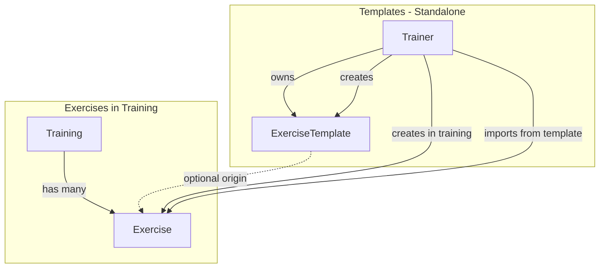

# Add Exercise Feature (Updated)

> **Design**: ExerciseTemplate + Exercise, mirrorando TrainingTemplate + Training. É possível criar um exercício sem treino vinculado (ExerciseTemplate) e criar exercícios em treinos a partir de templates ou manualmente.

## Modelos Prisma

### ExerciseTemplate (standalone, como TrainingTemplate)

```prisma
model ExerciseTemplate {
  id        String  @id @default(uuid()) @db.Uuid
  trainerId String  @map("trainer_id") @db.Uuid
  name      String  @db.Text
  type      String  @db.Text
  videoUrl  String? @map("video_url") @db.Text
  isPublic  Boolean @default(false) @map("is_public")

  // Execution method fields
  sets          Int?
  repetitions   Int?
  duration      Int?
  hasLoad       Boolean @default(false) @map("has_load")
  suggestedLoad Float?  @map("suggested_load")

  createdAt DateTime  @default(now()) @map("created_at") @db.Timestamptz(6)
  updatedAt DateTime? @updatedAt @map("updated_at") @db.Timestamptz(6)
  deletedAt DateTime? @map("deleted_at") @db.Timestamptz(6)

  trainer  Trainer   @relation(fields: [trainerId], references: [id], onDelete: Restrict)
  exercises Exercise[]

  @@map("exercise_templates")
}
```

### Exercise (dentro do treino, opcionalmente de template)

```prisma
model Exercise {
  id                 String  @id @default(uuid()) @db.Uuid
  trainingId         String  @map("training_id") @db.Uuid
  exerciseTemplateId String? @map("exercise_template_id") @db.Uuid
  name               String  @db.Text
  type               String  @db.Text
  videoUrl           String? @map("video_url") @db.Text
  order              Int     @default(0)

  // Execution method fields
  sets          Int?
  repetitions   Int?
  duration      Int?
  hasLoad       Boolean @default(false) @map("has_load")
  suggestedLoad Float?  @map("suggested_load")

  createdAt DateTime  @default(now()) @map("created_at") @db.Timestamptz(6)
  updatedAt DateTime? @updatedAt @map("updated_at") @db.Timestamptz(6)
  deletedAt DateTime? @map("deleted_at") @db.Timestamptz(6)

  training         Training         @relation(fields: [trainingId], references: [id], onDelete: Cascade)
  exerciseTemplate ExerciseTemplate? @relation(fields: [exerciseTemplateId], references: [id], onDelete: SetNull)

  @@map("exercises")
}
```

- Adicionar `exerciseTemplates ExerciseTemplate[]` e `exercises Exercise[]` no modelo `Trainer`
- Adicionar `exercises Exercise[]` no modelo `Training`
- `duration` em segundos (Int)
- `suggestedLoad` como Float sem unidade

## Fluxo



## Rotas

### ExerciseTemplate (como training-template-route)

| Método | Rota | Descrição |
|--------|------|-----------|
| POST | `/trainer/exercise-templates` | Criar template |
| GET | `/trainer/exercise-templates` | Listar (próprios + públicos) |
| GET | `/trainer/exercise-templates/public` | Listar só públicos |
| GET | `/trainer/exercise-templates/:id` | Buscar por ID |
| PATCH | `/trainer/exercise-templates/:id` | Atualizar |
| DELETE | `/trainer/exercise-templates/:id` | Soft delete |

### Exercise (como training-route)

| Método | Rota | Descrição |
|--------|------|-----------|
| POST | `/trainer/trainings/:trainingId/exercises` | Criar exercício |
| POST | `/trainer/exercises/from-template` | Criar exercício a partir de template |
| GET | `/trainer/trainings/:trainingId/exercises` | Listar exercícios do treino |
| GET | `/trainer/exercises/:id` | Buscar exercício por ID |
| PATCH | `/trainer/exercises/:id` | Atualizar |
| DELETE | `/trainer/exercises/:id` | Soft delete |

**Assignee (read-only):**

| Método | Rota |
|--------|------|
| GET | `/my/trainings/:trainingId/exercises` |
| GET | `/my/exercises/:id` |

## Services

- **exercise-template-service.js**: `createExerciseTemplate`, `getExerciseTemplatesByTrainer`, `getPublicExerciseTemplates`, `getExerciseTemplateById`, `updateExerciseTemplate`, `deleteExerciseTemplate`
- **exercise-service.js**: `createExercise`, `createFromTemplate`, `getExercisesByTraining`, `getExerciseById`, `updateExercise`, `deleteExercise`

## Arquivos a criar/alterar

1. `prisma/schema.prisma` – ExerciseTemplate + Exercise + relations
2. `src/constants/training.js` – ExerciseType + exerciseTypeValues
3. `src/helpers/training-validators.js` – validateExerciseType
4. `src/services/exercise-template-service.js` – novo
5. `src/services/exercise-service.js` – novo
6. `api/schemas/exercise-template-route.schema.js` – novo
7. `api/schemas/exercise-route.schema.js` – novo
8. `api/routes/exercise-template-route.js` – novo
9. `api/routes/exercise-route.js` – novo
10. `api/server.js` – registrar ambas as rotas
11. Testes unitários e E2E
12. Postman collection
