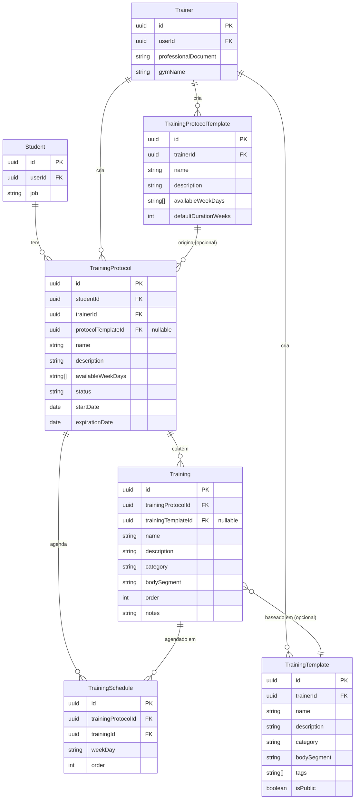
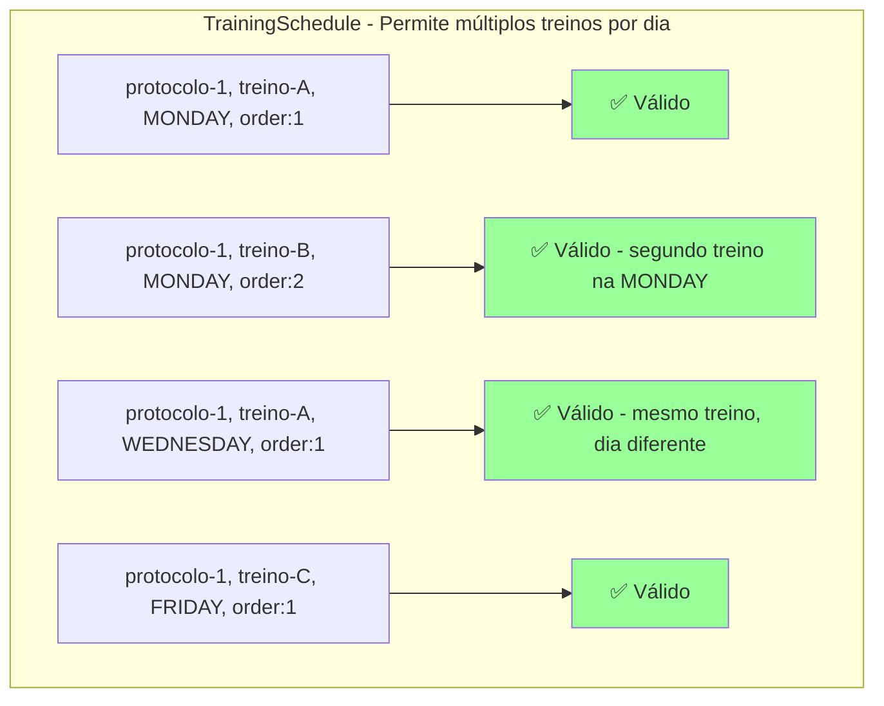
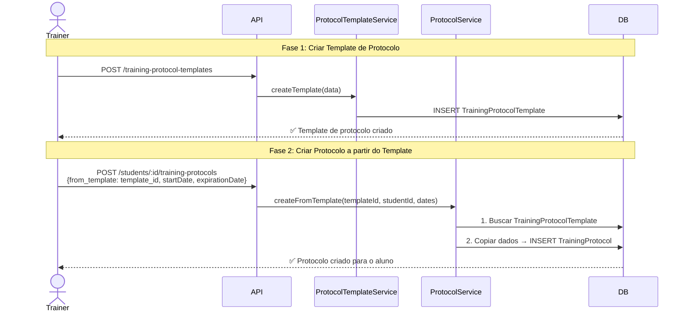
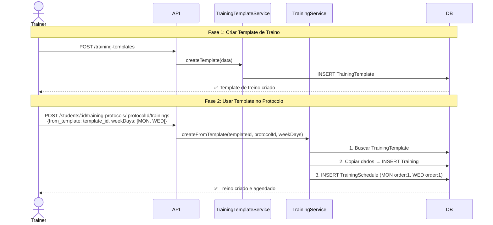
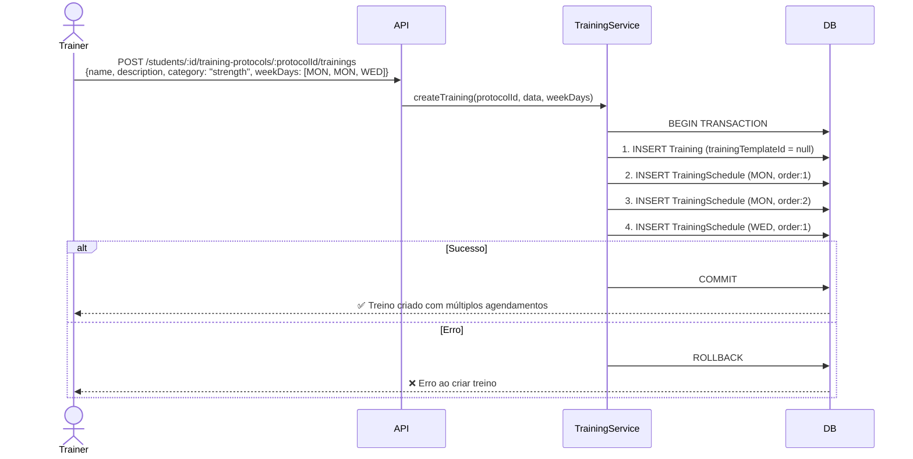
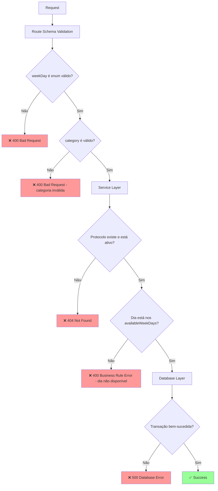

# ADR 001: Arquitetura do Sistema de Treinos

## Status

**Proposto** - 2026-02-04
**Atualizado** - 2026-02-08

## Contexto

O Treinoway Service precisa de uma funcionalidade que permita treinadores criarem e gerenciarem treinos para seus alunos. O sistema deve suportar:

1. **Templates de Protocolos**: Treinadores podem criar templates reutilizáveis de protocolos de treino
2. **Protocolos de Treino**: Estrutura organizacional que agrupa treinos por período (data início/expiração), podendo ter múltiplos protocolos ativos por aluno
3. **Templates de Treino**: Treinadores podem criar templates reutilizáveis de treinos individuais
4. **Treinos específicos**: Treinos criados para alunos específicos, seja do zero ou importados de templates
5. **Distribuição semanal**: Treinos atribuídos a dias da semana específicos, permitindo múltiplos treinos no mesmo dia

### Regras de Negócio Críticas

- **RN1**: Um protocolo pode ter múltiplos treinos no mesmo dia (permite treinos em sequência)
- **RN2**: Um mesmo treino pode aparecer em múltiplos dias da semana (ex: Treino A na segunda e quarta)
- **RN3**: Dias da semana podem ficar sem treino ou marcados como "descanso"
- **RN4**: Templates (protocolos e treinos) não estão vinculados a alunos específicos
- **RN5**: Ao importar um template, o item criado é uma cópia independente (editável sem afetar o template original)
- **RN6**: Um aluno pode ter um ou mais protocolos ativos simultaneamente

## Decisão

Adotamos uma arquitetura de **5 entidades** com tabela intermediária para garantir integridade referencial:

### Entidades

1. **TrainingProtocolTemplate** (Template de Protocolo)
   - Template reutilizável para criar protocolos rapidamente
   - Não vinculado a alunos
   - Criado e gerenciado por treinadores
   - Permite padronização de protocolos

2. **TrainingProtocol** (Protocolo de Treino)
   - Organizador principal, vinculado a um aluno e criado por um treinador
   - Contém metadados: nome, descrição, datas de início/expiração
   - Um aluno pode ter múltiplos protocolos ativos
   - Define os dias disponíveis para treinos

3. **TrainingTemplate** (Template de Treino)
   - Template reutilizável de treinos individuais, não vinculado a alunos
   - Criado e gerenciado por treinadores
   - Pode ser público ou privado

4. **Training** (Treino)
   - Treino específico dentro de um protocolo
   - Pode ser baseado em um template (opcional)
   - Contém dados copiados do template (se aplicável) para permitir edição independente
   - Pode ter categoria "rest" (descanso)

5. **TrainingSchedule** (Agenda de Treino)
   - Tabela intermediária que mapeia treinos para dias da semana
   - Permite múltiplos treinos no mesmo dia

### Campos Editáveis por Entidade

#### TrainingProtocolTemplate (Template de Protocolo)

Campos que o treinador pode preencher ao criar/editar um template de protocolo:

| Campo | Tipo | Obrigatório | Descrição |
|-------|------|-------------|-----------|
| `name` | String | ✅ Sim | Nome do template do protocolo |
| `description` | String | ⚪ Opcional | Descrição detalhada do protocolo |
| `availableWeekDays` | String[] | ✅ Sim | Dias disponíveis para treinos (ex: ["MONDAY", "WEDNESDAY", "FRIDAY"]) |
| `defaultDurationWeeks` | Int | ⚪ Opcional | Duração padrão em semanas (ex: 12) |

**Campos automáticos:** `id`, `trainerId`, `createdAt`, `updatedAt`, `deletedAt`

#### TrainingProtocol (Protocolo de Treino)

Campos que o treinador pode preencher ao criar/editar um protocolo:

| Campo | Tipo | Obrigatório | Descrição |
|-------|------|-------------|-----------|
| `name` | String | ✅ Sim | Nome do protocolo (ex: "Protocolo Hipertrofia Q1/2026") |
| `description` | String | ⚪ Opcional | Descrição ou objetivos do protocolo |
| `availableWeekDays` | String[] | ✅ Sim | Dias disponíveis para adicionar treinos |
| `status` | String | ⚪ Opcional | Status: `active`, `completed`, `archived` (padrão: `active`) |
| `startDate` | Date | ✅ Sim | Data de início do protocolo |
| `expirationDate` | Date | ⚪ Opcional | Data de expiração (pode ser indefinido) |
| `studentId` | UUID | ✅ Sim | ID do aluno vinculado |
| `protocolTemplateId` | UUID | ⚪ Opcional | Referência ao template original (se baseado em template) |

**Campos automáticos:** `id`, `trainerId`, `createdAt`, `updatedAt`, `deletedAt`

**Observação:** Um aluno pode ter múltiplos protocolos ativos ao mesmo tempo.

#### TrainingTemplate (Template de Treino)

Campos que o treinador pode preencher ao criar/editar um template de treino:

| Campo | Tipo | Obrigatório | Descrição |
|-------|------|-------------|-----------|
| `name` | String | ✅ Sim | Nome do template de treino |
| `description` | String | ⚪ Opcional | Descrição detalhada do treino |
| `category` | String | ⚪ Opcional | Categoria: `strength`, `cardio`, `flexibility`, `rest`, etc. |
| `bodySegment` | String | ⚪ Opcional | Segmento corporal: `upper`, `lower`, `full` |
| `tags` | String[] | ⚪ Opcional | Tags para organização (array vazio por padrão) |
| `isPublic` | Boolean | ⚪ Opcional | Se o template é público (padrão: `false`) |

**Campos automáticos:** `id`, `trainerId`, `createdAt`, `updatedAt`, `deletedAt`

#### Training (Treino)

Campos que o treinador pode preencher ao criar/editar um treino:

| Campo | Tipo | Obrigatório | Descrição |
|-------|------|-------------|-----------|
| `name` | String | ✅ Sim | Nome do treino (ex: "Treino Superior A") |
| `description` | String | ⚪ Opcional | Descrição do treino |
| `category` | String | ⚪ Opcional | Categoria: `strength`, `cardio`, `flexibility`, `rest` (copiado do template se aplicável) |
| `bodySegment` | String | ⚪ Opcional | Segmento corporal (copiado do template se aplicável) |
| `order` | Int | ⚪ Opcional | Ordem de execução no dia (padrão: `0`) |
| `notes` | String | ⚪ Opcional | Observações específicas para o aluno |
| `trainingTemplateId` | UUID | ⚪ Opcional | Referência ao template original (se baseado em template) |

**Campos automáticos:** `id`, `trainingProtocolId`, `createdAt`, `updatedAt`, `deletedAt`

**Observação:**
- Ao importar de um template, os campos `category` e `bodySegment` são **copiados** do `TrainingTemplate`, permitindo edição independente.
- A categoria `rest` indica um dia de descanso ativo ou recuperação.

#### TrainingSchedule (Agenda de Treino)

Campos preenchidos ao agendar um treino:

| Campo | Tipo | Obrigatório | Descrição |
|-------|------|-------------|-----------|
| `weekDay` | String | ✅ Sim | Dia da semana: `MONDAY`, `TUESDAY`, `WEDNESDAY`, `THURSDAY`, `FRIDAY`, `SATURDAY`, `SUNDAY` |
| `trainingId` | UUID | ✅ Sim | ID do treino a ser agendado |
| `order` | Int | ⚪ Opcional | Ordem de execução quando há múltiplos treinos no mesmo dia |

**Campos automáticos:** `id`, `trainingProtocolId`, `createdAt`

**Observação:** Múltiplos treinos podem ser agendados para o mesmo dia, diferenciados pelo campo `order`.

### Diagrama de Entidade-Relacionamento



### Diagrama de Múltiplos Treinos por Dia

A **RN1** permite múltiplos treinos no mesmo dia, diferenciados pelo campo `order`:

**Visualização:**



**Exemplo de dia com múltiplos treinos:**
- MONDAY: Treino A (Aquecimento, order:1) → Treino B (Principal, order:2) → Treino C (Alongamento, order:3)

### Schema Prisma

```prisma
model TrainingProtocolTemplate {
  id                    String    @id @default(uuid()) @db.Uuid
  name                  String    @db.Text
  description           String?   @db.Text
  availableWeekDays     String[]  @default([]) @map("available_week_days")
  defaultDurationWeeks  Int?      @map("default_duration_weeks")

  trainerId             String    @map("trainer_id") @db.Uuid

  createdAt             DateTime  @default(now()) @map("created_at") @db.Timestamptz(6)
  updatedAt             DateTime? @updatedAt @map("updated_at") @db.Timestamptz(6)
  deletedAt             DateTime? @map("deleted_at") @db.Timestamptz(6)

  trainer               Trainer             @relation(fields: [trainerId], references: [id], onDelete: Restrict)
  protocols             TrainingProtocol[]

  @@index([trainerId])
  @@map("training_protocol_templates")
}

model TrainingProtocol {
  id                  String    @id @default(uuid()) @db.Uuid
  name                String    @db.Text
  description         String?   @db.Text
  availableWeekDays   String[]  @default([]) @map("available_week_days")
  status              String    @default("active") @db.Text // active, completed, archived
  startDate           DateTime  @map("start_date") @db.Date
  expirationDate      DateTime? @map("expiration_date") @db.Date

  studentId           String    @map("student_id") @db.Uuid
  trainerId           String    @map("trainer_id") @db.Uuid
  protocolTemplateId  String?   @map("protocol_template_id") @db.Uuid

  createdAt           DateTime  @default(now()) @map("created_at") @db.Timestamptz(6)
  updatedAt           DateTime? @updatedAt @map("updated_at") @db.Timestamptz(6)
  deletedAt           DateTime? @map("deleted_at") @db.Timestamptz(6)

  student             Student                   @relation(fields: [studentId], references: [id], onDelete: Restrict)
  trainer             Trainer                   @relation(fields: [trainerId], references: [id], onDelete: Restrict)
  protocolTemplate    TrainingProtocolTemplate? @relation(fields: [protocolTemplateId], references: [id], onDelete: SetNull)
  trainings           Training[]
  schedules           TrainingSchedule[]

  @@index([studentId])
  @@index([trainerId])
  @@index([protocolTemplateId])
  @@map("training_protocols")
}

model TrainingTemplate {
  id          String    @id @default(uuid()) @db.Uuid
  name        String    @db.Text
  description String?   @db.Text
  category    String?   @db.Text // strength, cardio, flexibility, rest, etc.
  bodySegment String?   @map("body_segment") @db.Text // upper, lower, full
  tags        String[]  @default([])
  isPublic    Boolean   @default(false) @map("is_public")

  trainerId   String    @map("trainer_id") @db.Uuid

  createdAt   DateTime  @default(now()) @map("created_at") @db.Timestamptz(6)
  updatedAt   DateTime? @updatedAt @map("updated_at") @db.Timestamptz(6)
  deletedAt   DateTime? @map("deleted_at") @db.Timestamptz(6)

  trainer     Trainer   @relation(fields: [trainerId], references: [id], onDelete: Restrict)
  trainings   Training[]

  @@index([trainerId])
  @@map("training_templates")
}

model Training {
  id                  String    @id @default(uuid()) @db.Uuid
  name                String    @db.Text
  description         String?   @db.Text
  category            String?   @db.Text // strength, cardio, flexibility, rest, etc.
  bodySegment         String?   @map("body_segment") @db.Text
  order               Int       @default(0)
  notes               String?   @db.Text

  trainingProtocolId  String    @map("training_protocol_id") @db.Uuid
  trainingTemplateId  String?   @map("training_template_id") @db.Uuid

  createdAt           DateTime  @default(now()) @map("created_at") @db.Timestamptz(6)
  updatedAt           DateTime? @updatedAt @map("updated_at") @db.Timestamptz(6)
  deletedAt           DateTime? @map("deleted_at") @db.Timestamptz(6)

  trainingProtocol    TrainingProtocol  @relation(fields: [trainingProtocolId], references: [id], onDelete: Cascade)
  trainingTemplate    TrainingTemplate? @relation(fields: [trainingTemplateId], references: [id], onDelete: SetNull)
  schedules           TrainingSchedule[]

  @@index([trainingProtocolId])
  @@index([trainingTemplateId])
  @@map("trainings")
}

model TrainingSchedule {
  id                 String   @id @default(uuid()) @db.Uuid
  trainingProtocolId String   @map("training_protocol_id") @db.Uuid
  trainingId         String   @map("training_id") @db.Uuid
  weekDay            String   @map("week_day") @db.Text
  order              Int      @default(0) // Ordem de execução quando há múltiplos treinos no dia

  createdAt          DateTime @default(now()) @map("created_at") @db.Timestamptz(6)

  trainingProtocol   TrainingProtocol @relation(fields: [trainingProtocolId], references: [id], onDelete: Cascade)
  training           Training         @relation(fields: [trainingId], references: [id], onDelete: Cascade)

  @@index([trainingProtocolId])
  @@index([trainingId])
  @@map("training_schedules")
}
```

## Fluxos de Uso

### Fluxo 1: Criar Template de Protocolo e Usar



### Fluxo 2: Criar Template de Treino e Usar



### Fluxo 3: Criar Treino do Zero (Múltiplos Treinos no Mesmo Dia)



## Exemplos de Dados

### Exemplo 1: Treino A repetido em 2 dias

```sql
-- TrainingProtocol
id: 'protocol-1', studentId: 'student-1', name: 'Protocolo Hipertrofia Q1/2026'
availableWeekDays: ['MONDAY', 'TUESDAY', 'WEDNESDAY', 'THURSDAY', 'FRIDAY']

-- Training
id: 'training-A', trainingProtocolId: 'protocol-1', name: 'Treino Superior A', category: 'strength'
id: 'training-B', trainingProtocolId: 'protocol-1', name: 'Treino Inferior B', category: 'strength'

-- TrainingSchedule (✅ Válido)
id: 'sched-1', trainingProtocolId: 'protocol-1', trainingId: 'training-A', weekDay: 'MONDAY', order: 1
id: 'sched-2', trainingProtocolId: 'protocol-1', trainingId: 'training-A', weekDay: 'WEDNESDAY', order: 1
id: 'sched-3', trainingProtocolId: 'protocol-1', trainingId: 'training-B', weekDay: 'FRIDAY', order: 1

-- Resultado: Segunda (A), Quarta (A), Sexta (B)
```

### Exemplo 2: Múltiplos treinos no mesmo dia

```sql
-- TrainingProtocol
id: 'protocol-1', studentId: 'student-1', name: 'Protocolo Completo'

-- Training
id: 'training-A', name: 'Aquecimento', category: 'cardio'
id: 'training-B', name: 'Treino Principal', category: 'strength'
id: 'training-C', name: 'Alongamento', category: 'flexibility'
id: 'training-D', name: 'Descanso Ativo', category: 'rest'

-- TrainingSchedule (✅ Válido - múltiplos treinos na MONDAY)
id: 'sched-1', trainingProtocolId: 'protocol-1', trainingId: 'training-A', weekDay: 'MONDAY', order: 1
id: 'sched-2', trainingProtocolId: 'protocol-1', trainingId: 'training-B', weekDay: 'MONDAY', order: 2
id: 'sched-3', trainingProtocolId: 'protocol-1', trainingId: 'training-C', weekDay: 'MONDAY', order: 3
id: 'sched-4', trainingProtocolId: 'protocol-1', trainingId: 'training-D', weekDay: 'TUESDAY', order: 1

-- Resultado:
-- Segunda: Aquecimento (order:1) → Treino Principal (order:2) → Alongamento (order:3)
-- Terça: Descanso Ativo (order:1)
```

### Exemplo 3: Aluno com múltiplos protocolos ativos

```sql
-- Student
id: 'student-1', name: 'João Silva'

-- TrainingProtocol #1 (Hipertrofia)
id: 'protocol-1', studentId: 'student-1', name: 'Protocolo Hipertrofia'
status: 'active', startDate: '2026-01-01', expirationDate: '2026-03-31'

-- TrainingProtocol #2 (Condicionamento)
id: 'protocol-2', studentId: 'student-1', name: 'Protocolo Condicionamento'
status: 'active', startDate: '2026-02-01', expirationDate: '2026-04-30'

-- ✅ Válido: Aluno pode ter múltiplos protocolos ativos ao mesmo tempo
```

## Alternativas Consideradas

### Alternativa 1: Array de weekDays no Training ❌

```prisma
model Training {
  id       String   @id
  weekDays String[] @default([])  // ["MONDAY", "WEDNESDAY"]
  // ...
}
```

**Problemas:**
- ❌ Não permite múltiplos treinos no mesmo dia (cada treino tem seu array de dias)
- ❌ Dificulta ordenação quando há múltiplos treinos no mesmo dia
- ❌ Consultas complexas (ex: "quais treinos na segunda?") requerem `WHERE 'MONDAY' = ANY(weekDays)`

**Por que rejeitamos:** Não suporta a nova RN1 (múltiplos treinos por dia) de forma eficiente.

### Alternativa 2: Não ter TrainingProtocolTemplate ❌

**Proposta:** Não criar a entidade `TrainingProtocolTemplate`, forçando treinadores a criar protocolos do zero sempre.

**Problemas:**
- ❌ Treinadores perdem produtividade ao criar protocolos similares repetidamente
- ❌ Dificulta padronização de protocolos entre diferentes alunos
- ❌ Não permite reaproveitar configurações de protocolos bem-sucedidos

**Por que rejeitamos:** Templates são essenciais para produtividade e padronização.

### Alternativa 3: Coluna para cada dia da semana ❌

```prisma
model TrainingProtocol {
  mondayTrainingId    String? @db.Uuid
  tuesdayTrainingId   String? @db.Uuid
  wednesdayTrainingId String? @db.Uuid
  // ...
}
```

**Problemas:**
- ❌ Não permite repetir um treino em múltiplos dias
- ❌ Não permite múltiplos treinos no mesmo dia
- ❌ Schema rígido e não escalável

**Por que rejeitamos:** Muito inflexível, não suporta os casos de uso necessários.

### Alternativa 4: Unique constraint em (trainingProtocolId, trainingId, weekDay) ❌

```prisma
@@unique([trainingProtocolId, trainingId, weekDay])
```

**Problemas:**
- ❌ Impede que um mesmo treino apareça duas vezes no mesmo dia (ex: treino A de manhã e à tarde)
- ❌ Limita flexibilidade sem benefício claro

**Por que rejeitamos:** Casos de uso válidos requerem essa flexibilidade (treinos repetidos no dia).

## Consequências

### Positivas ✅

1. **Flexibilidade máxima**: Suporta múltiplos treinos no mesmo dia, treinos repetidos em dias diferentes, e múltiplos protocolos ativos por aluno
2. **Templates reutilizáveis**: Tanto protocolos quanto treinos podem ser criados a partir de templates, aumentando produtividade
3. **Escalável**: Fácil adicionar features futuras (horários específicos, substituições, progressões, etc.)
4. **Queries eficientes**: Índices otimizados para buscar treinos por dia/protocolo
5. **Auditoria completa**: TrainingSchedule mantém histórico de quando treinos foram agendados
6. **Isolamento**: Templates não são afetados por mudanças em protocolos/treinos específicos
7. **Ordenação clara**: Campo `order` em TrainingSchedule define sequência de execução de treinos no mesmo dia
8. **Categoria "rest"**: Permite marcar dias de descanso explicitamente no protocolo
9. **Protocolos múltiplos**: Aluno pode ter protocolos de hipertrofia + condicionamento simultaneamente

### Negativas ⚠️

1. **Complexidade aumentada**: 5 tabelas em vez de 2-3
2. **Joins adicionais**: Consultas precisam de JOIN com TrainingSchedule e templates
3. **Transações obrigatórias**: Criar Training + Schedules deve ser atômico
4. **Validação de ordem**: Aplicação deve gerenciar sequência de treinos no mesmo dia
5. **Possibilidade de agendamentos duplicados**: Sem constraint único, aplicação deve validar duplicatas indesejadas

### Mitigações

- Service layer abstrai a complexidade (ex: `createTraining` gerencia Training + Schedules + Order)
- Testes de integração garantem que transações funcionam corretamente
- Prisma facilita queries com `include: { schedules: true, protocolTemplate: true }`
- Validação de ordem é feita na camada de serviço antes de persistir
- API retorna treinos ordenados automaticamente pelo campo `order`

## Validações em Múltiplas Camadas

Para garantir robustez, implementamos validação em 3 camadas:



### Camada 1: Route Schema (Fastify JSON Schema)

```javascript
// api/schemas/training-schema.js
const weekDayEnum = ['MONDAY', 'TUESDAY', 'WEDNESDAY', 'THURSDAY', 'FRIDAY', 'SATURDAY', 'SUNDAY'];
const categoryEnum = ['strength', 'cardio', 'flexibility', 'rest'];

export const createTrainingSchema = {
  body: {
    type: 'object',
    required: ['name', 'weekDays'],
    properties: {
      name: { type: 'string', minLength: 1 },
      category: { type: 'string', enum: categoryEnum },
      weekDays: {
        type: 'array',
        items: { type: 'string', enum: weekDayEnum },
        minItems: 1
        // Nota: uniqueItems removido para permitir múltiplos agendamentos no mesmo dia
      }
    }
  }
};
```

### Camada 2: Service Layer

```javascript
// src/services/training-service.js
async createTraining(trainingProtocolId, trainingData, weekDays) {
  // Buscar protocolo e validar
  const protocol = await prisma.trainingProtocol.findUnique({
    where: { id: trainingProtocolId }
  });

  if (!protocol) {
    throw new NotFoundError('Protocolo não encontrado');
  }

  // Validar se os dias estão disponíveis no protocolo
  const invalidDays = weekDays.filter(day => !protocol.availableWeekDays.includes(day));
  if (invalidDays.length > 0) {
    throw new BusinessRuleError(`Dias não disponíveis no protocolo: ${invalidDays.join(', ')}`);
  }

  // Criar treino + schedules atomicamente
  return prisma.$transaction(async (tx) => {
    const training = await tx.training.create({ data: trainingData });

    // Agrupar por dia e atribuir ordem sequencial
    const dayCount = {};
    const schedules = weekDays.map(day => {
      dayCount[day] = (dayCount[day] || 0) + 1;
      return {
        trainingProtocolId,
        trainingId: training.id,
        weekDay: day,
        order: dayCount[day]
      };
    });

    await tx.trainingSchedule.createMany({ data: schedules });
    return training;
  });
}
```

### Camada 3: Database Layer

```prisma
// Sem constraint único - permite múltiplos treinos no mesmo dia
// Validação de integridade referencial via FK constraints
```

## Próximos Passos

1. Criar migration Prisma para as 5 tabelas:
   - `training_protocol_templates`
   - `training_protocols`
   - `training_templates`
   - `trainings`
   - `training_schedules`

2. Implementar services:
   - `training-protocol-template-service.js` - CRUD de templates de protocolos
   - `training-protocol-service.js` - CRUD de protocolos, suporte a múltiplos protocolos ativos
   - `training-template-service.js` - CRUD de templates de treinos
   - `training-service.js` - CRUD de treinos, suporte a categoria "rest", ordenação

3. Criar routes:
   - `/training-protocol-templates` - Gerenciar templates de protocolos
   - `/training-templates` - Gerenciar templates de treinos
   - `/students/:id/training-protocols` - Gerenciar protocolos do aluno
   - `/students/:id/training-protocols/:protocolId/trainings` - Gerenciar treinos do protocolo

4. Adicionar validações:
   - Validar `availableWeekDays` ao criar/editar protocolos
   - Validar categoria "rest" nos treinos
   - Validar ordenação de múltiplos treinos no mesmo dia
   - Validar que dias agendados estão em `availableWeekDays` do protocolo

5. Adicionar testes unitários:
   - Testar criação de protocolos a partir de templates
   - Testar múltiplos treinos no mesmo dia
   - Testar múltiplos protocolos ativos por aluno
   - Testar categoria "rest"

6. Adicionar testes e2e para fluxos completos

7. Documentar API no Swagger com novos endpoints

## Referências

- [Prisma Schema Best Practices](https://www.prisma.io/docs/guides/database/advanced-database-tasks)
- [PostgreSQL Unique Constraints](https://www.postgresql.org/docs/current/ddl-constraints.html#DDL-CONSTRAINTS-UNIQUE-CONSTRAINTS)
- [ADR Template](https://github.com/joelparkerhenderson/architecture-decision-record)

---

**Autor:** Sistema Treinoway
**Revisores:** [Aguardando revisão]
**Última atualização:** 2026-02-08

## Changelog

### 2026-02-08 - Revisão Major
- Renomeado `TrainingPlan` → `TrainingProtocol`
- Renomeado `TrainingModel` → `TrainingTemplate`
- Adicionado `TrainingProtocolTemplate` para templates reutilizáveis de protocolos
- Alterada RN1: Agora permite múltiplos treinos no mesmo dia
- Adicionado campo `order` em `TrainingSchedule` para ordenação de treinos no dia
- Adicionado campo `availableWeekDays` em protocolos
- Renomeado `endDate` → `expirationDate` em protocolos
- Adicionada categoria `rest` para treinos de descanso
- Adicionada RN6: Aluno pode ter múltiplos protocolos ativos
- Removido constraint `@@unique([trainingProtocolId, weekDay])` do TrainingSchedule

### 2026-02-04 - Versão Inicial
- Proposta inicial com 4 entidades
- Constraint único de 1 treino por dia
