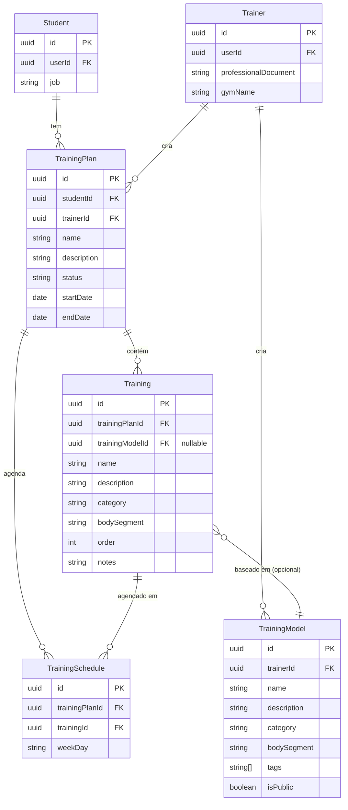
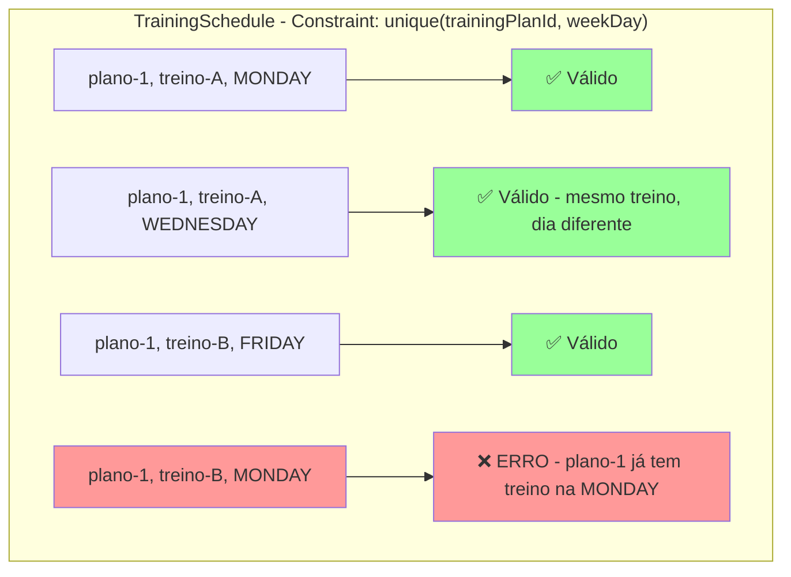
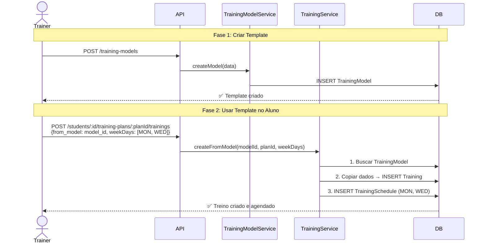
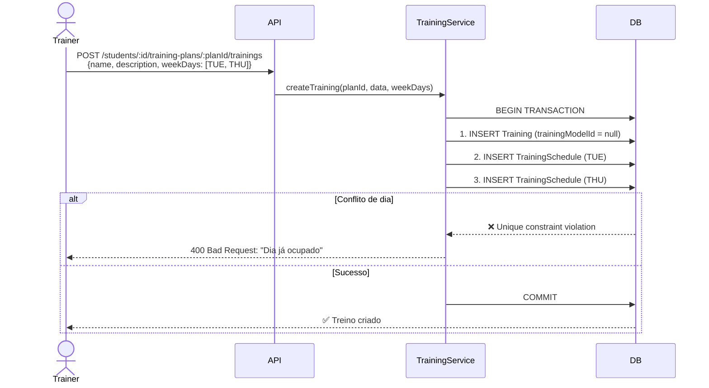
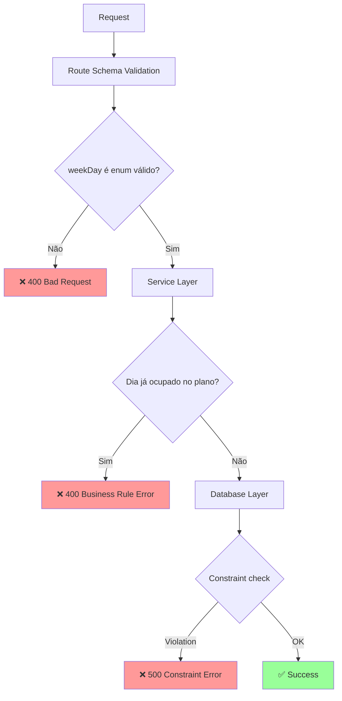

# ADR 001: Arquitetura do Sistema de Treinos

## Status

**Proposto** - 2026-02-04

## Contexto

O Treinoway Service precisa de uma funcionalidade que permita treinadores criarem e gerenciarem treinos para seus alunos. O sistema deve suportar:

1. **Templates reutilizáveis**: Treinadores podem criar "Modelos de Treino" que servem como templates
2. **Treinos específicos**: Treinos criados para alunos específicos, seja do zero ou importados de templates
3. **Planos de treino**: Estrutura organizacional que agrupa treinos por período (data início/fim)
4. **Distribuição semanal**: Treinos atribuídos a dias da semana específicos

### Regras de Negócio Críticas

- **RN1**: Um plano de treino não pode ter dois treinos diferentes no mesmo dia
- **RN2**: Um mesmo treino pode aparecer em múltiplos dias da semana (ex: Treino A na segunda e quarta)
- **RN3**: Dias da semana podem ficar sem treino
- **RN4**: Templates (modelos) não estão vinculados a alunos específicos
- **RN5**: Ao importar um template, o treino criado é uma cópia independente (editável sem afetar o template original)

## Decisão

Adotamos uma arquitetura de **4 entidades** com tabela intermediária para garantir integridade referencial:

### Entidades

1. **TrainingPlan** (Plano de Treino)
   - Organizador principal, vinculado a um aluno e criado por um treinador
   - Contém metadados: nome, descrição, datas, status

2. **TrainingModel** (Modelo de Treino)
   - Template reutilizável, não vinculado a alunos
   - Criado e gerenciado por treinadores
   - Pode ser público ou privado

3. **Training** (Treino)
   - Treino específico dentro de um plano
   - Pode ser baseado em um modelo (opcional)
   - Contém dados copiados do modelo (se aplicável) para permitir edição independente

4. **TrainingSchedule** (Agenda de Treino)
   - Tabela intermediária que mapeia treinos para dias da semana
   - Garante a regra "1 treino por dia no plano" via constraint de banco

### Campos Editáveis por Entidade

#### TrainingModel (Modelo de Treino)

Campos que o treinador pode preencher ao criar/editar um modelo:

| Campo | Tipo | Obrigatório | Descrição |
|-------|------|-------------|-----------|
| `name` | String | ✅ Sim | Nome do modelo de treino |
| `description` | String | ⚪ Opcional | Descrição detalhada do modelo |
| `category` | String | ⚪ Opcional | Categoria do treino (ex: "Hipertrofia", "Emagrecimento") |
| `bodySegment` | String | ⚪ Opcional | Segmento corporal: `upper`, `lower`, `full` |
| `tags` | String[] | ⚪ Opcional | Tags para organização (array vazio por padrão) |
| `isPublic` | Boolean | ⚪ Opcional | Se o modelo é público (padrão: `false`) |

**Campos automáticos:** `id`, `trainerId`, `createdAt`, `updatedAt`, `deletedAt`

#### TrainingPlan (Plano de Treino)

Campos que o treinador pode preencher ao criar/editar um plano:

| Campo | Tipo | Obrigatório | Descrição |
|-------|------|-------------|-----------|
| `name` | String | ✅ Sim | Nome do plano (ex: "Plano Janeiro/2026") |
| `description` | String | ⚪ Opcional | Descrição ou objetivos do plano |
| `status` | String | ⚪ Opcional | Status: `active`, `completed`, `archived` (padrão: `active`) |
| `startDate` | Date | ✅ Sim | Data de início do plano |
| `endDate` | Date | ⚪ Opcional | Data de término (pode ser indefinido) |
| `studentId` | UUID | ✅ Sim | ID do aluno vinculado |

**Campos automáticos:** `id`, `trainerId`, `createdAt`, `updatedAt`, `deletedAt`

#### Training (Treino)

Campos que o treinador pode preencher ao criar/editar um treino:

| Campo | Tipo | Obrigatório | Descrição |
|-------|------|-------------|-----------|
| `name` | String | ✅ Sim | Nome do treino (ex: "Treino Superior A") |
| `description` | String | ⚪ Opcional | Descrição do treino |
| `category` | String | ⚪ Opcional | Categoria (copiado do modelo se aplicável) |
| `bodySegment` | String | ⚪ Opcional | Segmento corporal (copiado do modelo se aplicável) |
| `order` | Int | ⚪ Opcional | Ordem de execução (padrão: `0`) |
| `notes` | String | ⚪ Opcional | Observações específicas para o aluno |
| `trainingModelId` | UUID | ⚪ Opcional | Referência ao modelo original (se baseado em template) |

**Campos automáticos:** `id`, `trainingPlanId`, `createdAt`, `updatedAt`, `deletedAt`

**Observação:** Ao importar de um modelo, os campos `category` e `bodySegment` são **copiados** do `TrainingModel`, permitindo edição independente.

#### TrainingSchedule (Agenda de Treino)

Campos preenchidos ao agendar um treino:

| Campo | Tipo | Obrigatório | Descrição |
|-------|------|-------------|-----------|
| `weekDay` | String | ✅ Sim | Dia da semana: `MONDAY`, `TUESDAY`, `WEDNESDAY`, `THURSDAY`, `FRIDAY`, `SATURDAY`, `SUNDAY` |
| `trainingId` | UUID | ✅ Sim | ID do treino a ser agendado |

**Campos automáticos:** `id`, `trainingPlanId`, `createdAt`

**Constraint:** `unique(trainingPlanId, weekDay)` garante que não há dois treinos diferentes no mesmo dia.

### Diagrama de Entidade-Relacionamento



### Diagrama de Constraint Crítico

A garantia da **RN1** (não ter dois treinos no mesmo dia) é feita pelo constraint:

```prisma
@@unique([trainingPlanId, weekDay])
```

**Visualização:**



### Schema Prisma

```prisma
model TrainingPlan {
  id          String    @id @default(uuid()) @db.Uuid
  name        String    @db.Text
  description String?   @db.Text
  status      String    @default("active") @db.Text // active, completed, archived
  startDate   DateTime  @map("start_date") @db.Date
  endDate     DateTime? @map("end_date") @db.Date

  studentId   String    @map("student_id") @db.Uuid
  trainerId   String    @map("trainer_id") @db.Uuid

  createdAt   DateTime  @default(now()) @map("created_at") @db.Timestamptz(6)
  updatedAt   DateTime? @updatedAt @map("updated_at") @db.Timestamptz(6)
  deletedAt   DateTime? @map("deleted_at") @db.Timestamptz(6)

  student     Student   @relation(fields: [studentId], references: [id], onDelete: Restrict)
  trainer     Trainer   @relation(fields: [trainerId], references: [id], onDelete: Restrict)
  trainings   Training[]
  schedules   TrainingSchedule[]

  @@index([studentId])
  @@index([trainerId])
  @@map("training_plans")
}

model TrainingModel {
  id          String    @id @default(uuid()) @db.Uuid
  name        String    @db.Text
  description String?   @db.Text
  category    String?   @db.Text
  bodySegment String?   @map("body_segment") @db.Text // upper, lower, full
  tags        String[]  @default([])
  isPublic    Boolean   @default(false) @map("is_public")

  trainerId   String    @map("trainer_id") @db.Uuid

  createdAt   DateTime  @default(now()) @map("created_at") @db.Timestamptz(6)
  updatedAt   DateTime? @updatedAt @map("updated_at") @db.Timestamptz(6)
  deletedAt   DateTime? @map("deleted_at") @db.Timestamptz(6)

  trainer     Trainer   @relation(fields: [trainerId], references: [id], onDelete: Restrict)
  trainings   Training[]

  @@index([trainerId])
  @@map("training_models")
}

model Training {
  id              String    @id @default(uuid()) @db.Uuid
  name            String    @db.Text
  description     String?   @db.Text
  category        String?   @db.Text
  bodySegment     String?   @map("body_segment") @db.Text
  order           Int       @default(0)
  notes           String?   @db.Text

  trainingPlanId  String    @map("training_plan_id") @db.Uuid
  trainingModelId String?   @map("training_model_id") @db.Uuid

  createdAt       DateTime  @default(now()) @map("created_at") @db.Timestamptz(6)
  updatedAt       DateTime? @updatedAt @map("updated_at") @db.Timestamptz(6)
  deletedAt       DateTime? @map("deleted_at") @db.Timestamptz(6)

  trainingPlan    TrainingPlan   @relation(fields: [trainingPlanId], references: [id], onDelete: Cascade)
  trainingModel   TrainingModel? @relation(fields: [trainingModelId], references: [id], onDelete: SetNull)
  schedules       TrainingSchedule[]

  @@index([trainingPlanId])
  @@index([trainingModelId])
  @@map("trainings")
}

model TrainingSchedule {
  id             String   @id @default(uuid()) @db.Uuid
  trainingPlanId String   @map("training_plan_id") @db.Uuid
  trainingId     String   @map("training_id") @db.Uuid
  weekDay        String   @map("week_day") @db.Text

  createdAt      DateTime @default(now()) @map("created_at") @db.Timestamptz(6)

  trainingPlan   TrainingPlan @relation(fields: [trainingPlanId], references: [id], onDelete: Cascade)
  training       Training     @relation(fields: [trainingId], references: [id], onDelete: Cascade)

  @@unique([trainingPlanId, weekDay])
  @@index([trainingId])
  @@map("training_schedules")
}
```

## Fluxos de Uso

### Fluxo 1: Criar Template e Usar



### Fluxo 2: Criar Treino do Zero



## Exemplos de Dados

### Exemplo Válido: Treino A repetido em 2 dias

```sql
-- TrainingPlan
id: 'plan-1', studentId: 'student-1', name: 'Plano Janeiro/2026'

-- Training
id: 'training-A', trainingPlanId: 'plan-1', name: 'Treino Superior A'
id: 'training-B', trainingPlanId: 'plan-1', name: 'Treino Inferior B'

-- TrainingSchedule (✅ Válido)
id: 'sched-1', trainingPlanId: 'plan-1', trainingId: 'training-A', weekDay: 'MONDAY'
id: 'sched-2', trainingPlanId: 'plan-1', trainingId: 'training-A', weekDay: 'WEDNESDAY'
id: 'sched-3', trainingPlanId: 'plan-1', trainingId: 'training-B', weekDay: 'FRIDAY'

-- Resultado: Segunda (A), Quarta (A), Sexta (B)
```

### Exemplo Inválido: Dois treinos no mesmo dia

```sql
-- TrainingSchedule
id: 'sched-1', trainingPlanId: 'plan-1', trainingId: 'training-A', weekDay: 'MONDAY'
id: 'sched-2', trainingPlanId: 'plan-1', trainingId: 'training-B', weekDay: 'MONDAY'
                                                                          ^^^^^^
-- ❌ ERRO: Unique constraint violation em (trainingPlanId, weekDay)
```

## Alternativas Consideradas

### Alternativa 1: Array de weekDays no Training ❌

```prisma
model Training {
  id       String   @id
  weekDays String[] @default([])  // ["MONDAY", "WEDNESDAY"]
  // ...
}
```

**Problemas:**
- ❌ Não há constraint nativo no PostgreSQL para validar "dias únicos entre trainings"
- ❌ Validação ficaria exclusivamente na camada de aplicação (race conditions possíveis)
- ❌ Consultas complexas (ex: "quais treinos na segunda?") requerem `WHERE 'MONDAY' = ANY(weekDays)`

**Por que rejeitamos:** Sem garantia de integridade no banco de dados.

### Alternativa 2: Unique em (trainingId, weekDay) ❌

```prisma
@@unique([trainingId, weekDay])
```

**Problemas:**
- ❌ Impede que um mesmo Training tenha o dia duplicado (OK)
- ❌ Mas PERMITE que `training-A` e `training-B` usem MONDAY no mesmo plano (ERRADO!)

**Por que rejeitamos:** Não resolve a regra de negócio principal.

### Alternativa 3: Coluna para cada dia da semana ❌

```prisma
model TrainingPlan {
  mondayTrainingId    String? @db.Uuid
  tuesdayTrainingId   String? @db.Uuid
  wednesdayTrainingId String? @db.Uuid
  // ...
}
```

**Problemas:**
- ❌ Não permite repetir um treino em múltiplos dias
- ❌ Schema rígido e não escalável

**Por que rejeitamos:** Muito inflexível, não suporta treino repetido.

## Consequências

### Positivas ✅

1. **Integridade garantida**: Constraint de banco impede estados inválidos
2. **Flexibilidade**: Suporta todos os cenários de uso (treino repetido, dias vazios, etc.)
3. **Escalável**: Fácil adicionar features futuras (horários, substituições, etc.)
4. **Queries eficientes**: Índices otimizados para buscar treinos por dia/plano
5. **Auditoria**: TrainingSchedule mantém histórico de quando treinos foram agendados
6. **Isolamento**: Templates não são afetados por mudanças em treinos específicos

### Negativas ⚠️

1. **Complexidade**: 4 tabelas em vez de 2-3 (mas justificado pela integridade)
2. **Joins adicionais**: Consultas precisam de JOIN com TrainingSchedule
3. **Transações obrigatórias**: Criar Training + Schedules deve ser atômico

### Mitigações

- Service layer abstrai a complexidade (ex: `createTraining` gerencia Training + Schedules)
- Testes de integração garantem que transações funcionam corretamente
- Prisma facilita queries com `include: { schedules: true }`

## Validações em Múltiplas Camadas

Para garantir robustez, implementamos validação em 3 camadas:



### Camada 1: Route Schema (Fastify JSON Schema)

```javascript
// api/schemas/training-schema.js
const weekDayEnum = ['MONDAY', 'TUESDAY', 'WEDNESDAY', 'THURSDAY', 'FRIDAY', 'SATURDAY', 'SUNDAY'];

export const createTrainingSchema = {
  body: {
    type: 'object',
    required: ['name', 'weekDays'],
    properties: {
      weekDays: {
        type: 'array',
        items: { type: 'string', enum: weekDayEnum },
        minItems: 1,
        uniqueItems: true
      }
    }
  }
};
```

### Camada 2: Service Layer

```javascript
// src/services/training-service.js
async createTraining(trainingPlanId, trainingData, weekDays) {
  // Verificar conflitos antes de inserir
  const existingSchedules = await prisma.trainingSchedule.findMany({
    where: {
      trainingPlanId,
      weekDay: { in: weekDays }
    }
  });

  if (existingSchedules.length > 0) {
    const conflicts = existingSchedules.map(s => s.weekDay);
    throw new BusinessRuleError(`Dias já ocupados: ${conflicts.join(', ')}`);
  }

  // Criar treino + schedules atomicamente
  return prisma.$transaction(async (tx) => {
    const training = await tx.training.create({ data: trainingData });
    await tx.trainingSchedule.createMany({
      data: weekDays.map(day => ({
        trainingPlanId,
        trainingId: training.id,
        weekDay: day
      }))
    });
    return training;
  });
}
```

### Camada 3: Database Constraint

```prisma
@@unique([trainingPlanId, weekDay])  // Última linha de defesa
```

## Próximos Passos

1. Criar migration Prisma para as 4 tabelas
2. Implementar services: `training-model-service.js`, `training-service.js`
3. Criar routes: `/training-models`, `/training-plans/:id/trainings`
4. Adicionar testes unitários para validações
5. Adicionar testes e2e para fluxos completos
6. Documentar API no Swagger

## Referências

- [Prisma Schema Best Practices](https://www.prisma.io/docs/guides/database/advanced-database-tasks)
- [PostgreSQL Unique Constraints](https://www.postgresql.org/docs/current/ddl-constraints.html#DDL-CONSTRAINTS-UNIQUE-CONSTRAINTS)
- [ADR Template](https://github.com/joelparkerhenderson/architecture-decision-record)

---

**Autor:** Sistema Treinoway
**Revisores:** [Aguardando revisão]
**Última atualização:** 2026-02-04
