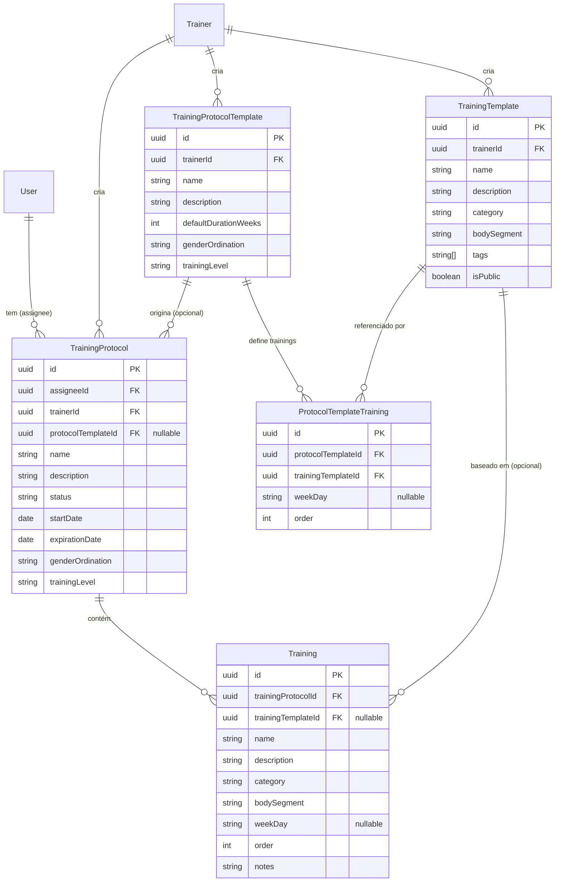
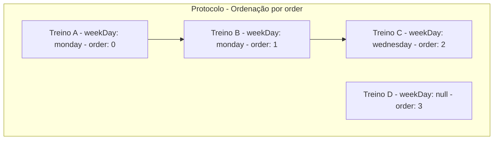
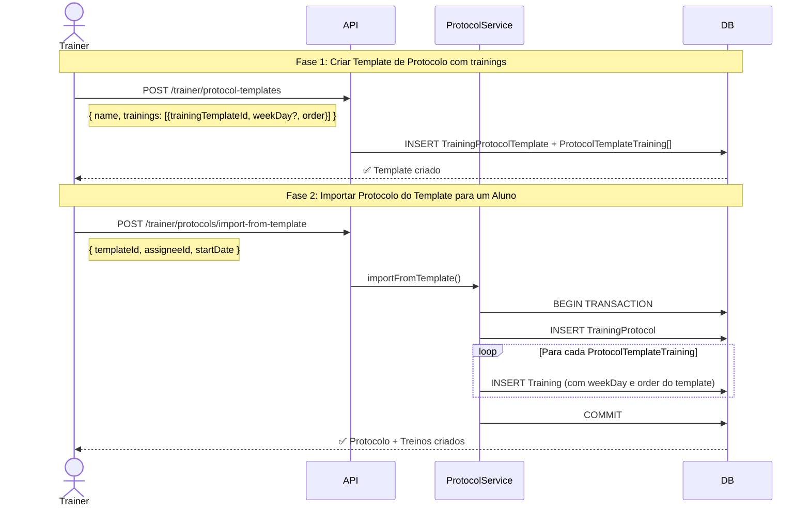
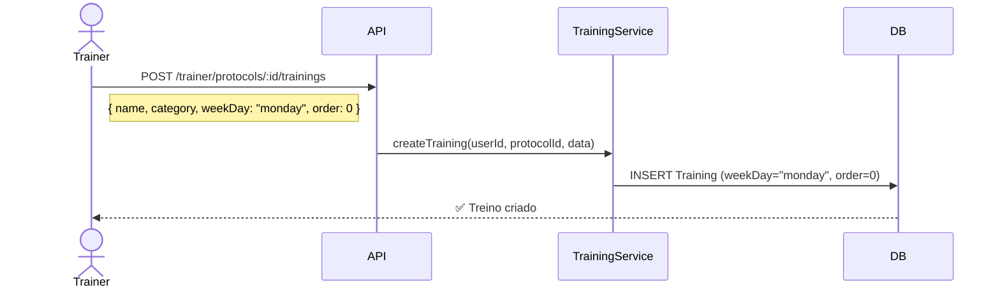

# ADR 001: Arquitetura do Sistema de Treinos

## Status

**Proposto** - 2026-02-04
**Atualizado** - 2026-02-27

## Contexto

O Treinoway Service precisa de uma funcionalidade que permita treinadores criarem e gerenciarem treinos para seus alunos. O sistema deve suportar:

1. **Templates de Protocolos**: Treinadores podem criar templates reutilizáveis de protocolos de treino
2. **Protocolos de Treino**: Estrutura organizacional que agrupa treinos por período (data início/expiração), podendo ter múltiplos protocolos ativos por aluno
3. **Templates de Treino**: Treinadores podem criar templates reutilizáveis de treinos individuais
4. **Treinos específicos**: Treinos criados para alunos específicos, seja do zero ou importados de templates
5. **Distribuição semanal**: O dia da semana é um campo opcional diretamente no treino (`weekDay`); a ordenação é definida pelo campo `order`

### Regras de Negócio Críticas

- **RN1**: Um protocolo pode ter múltiplos treinos no mesmo dia (diferenciados pelo campo `order`)
- **RN2**: O campo `weekDay` em `Training` é opcional — permite treinos sem dia fixo
- **RN3**: A ordenação dos treinos é definida pelo campo `order` (crescente)
- **RN4**: Templates (protocolos e treinos) não estão vinculados a alunos específicos
- **RN5**: Ao importar um template, o item criado é uma cópia independente (editável sem afetar o template original)
- **RN6**: Um aluno pode ter um ou mais protocolos ativos simultaneamente

## Decisão

Adotamos uma arquitetura de **5 entidades**:

### Entidades

1. **TrainingProtocolTemplate** (Template de Protocolo)
   - Template reutilizável para criar protocolos rapidamente
   - Não vinculado a alunos
   - Criado e gerenciado por treinadores
   - Vinculado a `ProtocolTemplateTraining` para pré-definir treinos e sua sequência/dias

2. **TrainingProtocol** (Protocolo de Treino)
   - Organizador principal, vinculado a um aluno (assignee) e criado por um treinador
   - Contém metadados: nome, descrição, datas de início/expiração, status
   - Um aluno pode ter múltiplos protocolos ativos

3. **TrainingTemplate** (Template de Treino)
   - Template reutilizável de treinos individuais, não vinculado a alunos
   - Criado e gerenciado por treinadores
   - Pode ser público ou privado

4. **Training** (Treino)
   - Treino específico dentro de um protocolo
   - Pode ser baseado em um template (opcional)
   - Campo `weekDay` opcional (nullable) — indica em que dia da semana o treino deve ser feito
   - Campo `order` define a sequência de execução

5. **ProtocolTemplateTraining** (Link Template de Protocolo → Template de Treino)
   - Tabela que vincula `TrainingProtocolTemplate` a `TrainingTemplate`
   - Contém `weekDay` (opcional) e `order` para pré-definir a programação
   - Usada ao importar um protocolo do template para criar os `Training` reais

### Campos Editáveis por Entidade

#### TrainingProtocolTemplate (Template de Protocolo)

| Campo | Tipo | Obrigatório | Descrição |
|-------|------|-------------|-----------|
| `name` | String | ✅ Sim | Nome do template do protocolo |
| `description` | String | ⚪ Opcional | Descrição detalhada do protocolo |
| `defaultDurationWeeks` | Int | ⚪ Opcional | Duração padrão em semanas (ex: 12) |
| `genderOrdination` | String | ⚪ Opcional | Orientação de gênero (`male`, `female`, `other`) |
| `trainingLevel` | String | ⚪ Opcional | Nível (`beginner`, `intermediate`, `advanced`, `athlete`) |
| `trainings` | Array | ⚪ Opcional | Links para training templates com weekDay e order |

**Campos automáticos:** `id`, `trainerId`, `createdAt`, `updatedAt`, `deletedAt`

#### TrainingProtocol (Protocolo de Treino)

| Campo | Tipo | Obrigatório | Descrição |
|-------|------|-------------|-----------|
| `name` | String | ✅ Sim | Nome do protocolo (ex: "Protocolo Hipertrofia Q1/2026") |
| `description` | String | ⚪ Opcional | Descrição ou objetivos do protocolo |
| `status` | String | ⚪ Opcional | Status: `active`, `completed`, `archived` (padrão: `active`) |
| `startDate` | Date | ✅ Sim | Data de início do protocolo |
| `expirationDate` | Date | ⚪ Opcional | Data de expiração (pode ser indefinido) |
| `assigneeId` | UUID | ✅ Sim | ID do aluno vinculado |
| `protocolTemplateId` | UUID | ⚪ Opcional | Referência ao template original (se baseado em template) |
| `genderOrdination` | String | ⚪ Opcional | Orientação de gênero |
| `trainingLevel` | String | ⚪ Opcional | Nível de treino |

**Campos automáticos:** `id`, `trainerId`, `createdAt`, `updatedAt`, `deletedAt`

#### TrainingTemplate (Template de Treino)

| Campo | Tipo | Obrigatório | Descrição |
|-------|------|-------------|-----------|
| `name` | String | ✅ Sim | Nome do template de treino |
| `description` | String | ⚪ Opcional | Descrição detalhada do treino |
| `category` | String | ⚪ Opcional | Categoria: `strength`, `cardio`, `flexibility`, `rest`, etc. |
| `bodySegment` | String | ⚪ Opcional | Segmento corporal: `upper`, `lower`, `core`, `full_body` |
| `tags` | String[] | ⚪ Opcional | Tags para organização (array vazio por padrão) |
| `isPublic` | Boolean | ⚪ Opcional | Se o template é público (padrão: `false`) |

**Campos automáticos:** `id`, `trainerId`, `createdAt`, `updatedAt`, `deletedAt`

#### Training (Treino)

| Campo | Tipo | Obrigatório | Descrição |
|-------|------|-------------|-----------|
| `name` | String | ✅ Sim | Nome do treino (ex: "Treino Superior A") |
| `description` | String | ⚪ Opcional | Descrição do treino |
| `category` | String | ✅ Sim | Categoria: `strength`, `cardio`, `flexibility`, `rest` |
| `bodySegment` | String | ⚪ Opcional | Segmento corporal (copiado do template se aplicável) |
| `weekDay` | String | ⚪ Opcional | Dia da semana (`monday`–`sunday`); null = sem dia fixo |
| `order` | Int | ⚪ Opcional | Ordem de execução dentro do protocolo (padrão: `0`) |
| `notes` | String | ⚪ Opcional | Observações específicas para o aluno |
| `trainingTemplateId` | UUID | ⚪ Opcional | Referência ao template original (se baseado em template) |

**Campos automáticos:** `id`, `trainingProtocolId`, `createdAt`, `updatedAt`, `deletedAt`

#### ProtocolTemplateTraining (Link Template ↔ Training Template)

| Campo | Tipo | Obrigatório | Descrição |
|-------|------|-------------|-----------|
| `protocolTemplateId` | UUID | ✅ Sim | Referência ao `TrainingProtocolTemplate` |
| `trainingTemplateId` | UUID | ✅ Sim | Referência ao `TrainingTemplate` |
| `weekDay` | String | ⚪ Opcional | Dia da semana sugerido para o treino |
| `order` | Int | ⚪ Opcional | Ordem sugerida (padrão: `0`) |

**Campos automáticos:** `id`, `createdAt`, `updatedAt`

### Diagrama de Entidade-Relacionamento



### Diagrama de Ordenação de Treinos

O campo `order` no `Training` define a sequência de execução dentro do protocolo:



**Exemplo:** Treino A e B na segunda (order 0 e 1), Treino C na quarta (order 2), Treino D sem dia fixo (order 3).

### Schema Prisma (resumo)

```prisma
model Training {
  id                 String  @id @default(uuid()) @db.Uuid
  trainingProtocolId String  @map("training_protocol_id") @db.Uuid
  trainingTemplateId String? @map("training_template_id") @db.Uuid
  name               String  @db.Text
  description        String? @db.Text
  category           String  @db.Text
  bodySegment        String? @map("body_segment") @db.Text
  weekDay            String? @map("week_day") @db.Text  // opcional
  order              Int     @default(0)
  notes              String? @db.Text
  // ... timestamps
  @@map("trainings")
}

model ProtocolTemplateTraining {
  id                 String  @id @default(uuid()) @db.Uuid
  protocolTemplateId String  @map("protocol_template_id") @db.Uuid
  trainingTemplateId String  @map("training_template_id") @db.Uuid
  weekDay            String? @map("week_day") @db.Text  // opcional
  order              Int     @default(0)
  // ... timestamps
  @@map("protocol_template_trainings")
}
```

## Fluxos de Uso

### Fluxo 1: Criar Protocolo a partir de Template



### Fluxo 2: Criar Treino do Zero com weekDay



## Alternativas Consideradas

### Alternativa 1 (rejeitada): Tabela separada `TrainingSchedule`

A versão anterior usava uma tabela intermediária `TrainingSchedule` para mapear treinos a dias da semana:

```
Training → TrainingSchedule (trainingId, weekDay, order)
```

**Problemas:**
- ❌ Complexidade desnecessária: a grande maioria dos casos de uso é 1 treino → 1 dia
- ❌ Queries mais complexas requerem JOIN extra para buscar treinos por dia
- ❌ Operações de criação/atualização de agendamento exigem transações com múltiplas tabelas
- ❌ A regra "um treino pode aparecer em múltiplos dias" criava duplicação de dados do treino

**Solução adotada:** `weekDay` como campo direto e opcional no `Training`, com `order` definindo a sequência.

### Alternativa 2 (rejeitada): Array de weekDays no Training

```prisma
model Training {
  weekDays String[] @default([])
}
```

**Problemas:**
- ❌ Dificulta ordenação quando há múltiplos treinos no mesmo dia
- ❌ Queries por dia requerem `WHERE 'monday' = ANY(weekDays)`

### Alternativa 3 (rejeitada): Não ter TrainingProtocolTemplate

**Problemas:**
- ❌ Treinadores perdem produtividade ao criar protocolos similares repetidamente

## Consequências

### Positivas ✅

1. **Simplicidade**: `weekDay` como campo direto elimina a tabela `TrainingSchedule`
2. **Flexibilidade**: `weekDay` nullable permite treinos sem dia fixo (ordem livre)
3. **Templates reutilizáveis**: Tanto protocolos quanto treinos podem ser criados a partir de templates
4. **Escalável**: Fácil adicionar features futuras (horários específicos, progressões, etc.)
5. **Queries simples**: Buscar treinos por dia não exige JOIN adicional
6. **Ordenação clara**: Campo `order` em `Training` define sequência de execução
7. **Categoria "rest"**: Permite marcar dias de descanso explicitamente no protocolo

### Negativas ⚠️

1. **weekDay não é exclusivo**: Um protocolo pode ter múltiplos treinos no mesmo dia; a aplicação gerencia a ordem via `order`
2. **Sem histórico de agendamento**: Sem a tabela intermediária, não há registro de quando um agendamento foi feito

### Mitigações

- Service layer abstrai a complexidade
- `order` define sequência de execução
- Testes de integração garantem comportamento correto
- Prisma facilita queries com `include: { trainings: { orderBy: { order: 'asc' } } }`

## Referências

- [Prisma Schema Best Practices](https://www.prisma.io/docs/guides/database/advanced-database-tasks)
- [ADR Template](https://github.com/joelparkerhenderson/architecture-decision-record)

---

**Autor:** Sistema Treinoway
**Revisores:** [Aguardando revisão]
**Última atualização:** 2026-02-27

## Changelog

### 2026-02-27 - Refactor Major: Remoção de TrainingSchedule
- Removido `TrainingSchedule` e `TrainingScheduleTemplate`
- Adicionado campo `weekDay` (nullable) diretamente em `Training`
- Renomeado `TrainingScheduleTemplate` → `ProtocolTemplateTraining` (weekDay agora nullable)
- Removido `availableWeekDays` de `TrainingProtocol` e `TrainingProtocolTemplate`
- Campo `order` em `Training` agora é o principal definidor de sequência

### 2026-02-08 - Revisão Major
- Renomeado `TrainingPlan` → `TrainingProtocol`
- Renomeado `TrainingModel` → `TrainingTemplate`
- Adicionado `TrainingProtocolTemplate` para templates reutilizáveis de protocolos
- Adicionado campo `availableWeekDays` em protocolos
- Adicionada categoria `rest` para treinos de descanso
- Adicionada RN6: Aluno pode ter múltiplos protocolos ativos

### 2026-02-04 - Versão Inicial
- Proposta inicial com 4 entidades
