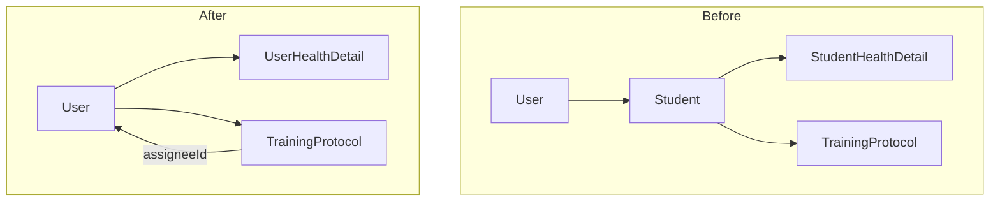

# Remove Student Entity and Migrate to User-Centric Model

**Overview:** Remove the Student entity entirely, move StudentHealthDetail to User (as UserHealthDetail), change TrainingProtocol to reference User directly (assignee), remove STUDENT role, and update all auth flows and routes.

---

## Summary

Remove `Student` and `StudentHealthDetail` entities. Move health data to `UserHealthDetail` (linked to User). Change `TrainingProtocol` to reference `userId` (assignee) instead of `studentId`. Remove `STUDENT` role. Authorization for "my protocols" becomes: authenticated user + `protocol.userId === request.user.id`.

---

## 1. Prisma Schema Changes

**File:** `prisma/schema.prisma`

- **Remove** `Student` model
- **Rename** `StudentHealthDetail` to `UserHealthDetail`:
  - Change `studentId` to `userId`
  - Relation: `User` (instead of Student)
  - Table: `user_health_details`
  - **1:1 with User** (use `@@unique([userId])`). A separate history table will be added later.
- **Update** `User`:
  - Remove `student Student?`
  - Add `healthDetail UserHealthDetail?` (singular, 1:1)
- **Update** `TrainingProtocol`:
  - Rename `studentId` to `assigneeId` (or `userId`)
  - Change relation from `Student` to `User`
  - Update `@@map` if column name changes
- **Update** `UserPreferences.activeProfile`: keep `"student"` as UI label for "view as protocol receiver" (optional; can rename later)

---

## 2. Database Migration

Create a Prisma migration that:

1. **Create** `user_health_details` table (same structure as `student_health_details`, with `user_id` instead of `student_id`, and `UNIQUE(user_id)` for 1:1)
2. **Migrate data**: For 1:1, take one record per user (e.g. most recent by `created_at`): `INSERT INTO user_health_details ... SELECT DISTINCT ON (s.user_id) ... FROM student_health_details sh JOIN students s ON sh.student_id = s.id ORDER BY s.user_id, sh.created_at DESC`
3. **Drop** `student_health_details`
4. **Alter** `training_protocols`: add `assignee_id` (or `user_id`) column
5. **Migrate**: `UPDATE training_protocols SET assignee_id = (SELECT user_id FROM students WHERE id = student_id)`
6. **Drop** `student_id` column and FK
7. **Add** FK `assignee_id` -> `users(id)`
8. **Drop** `students` table
9. **Clean up roles**: `UPDATE users SET roles = array_remove(roles, 'student') WHERE 'student' = ANY(roles)`

---

## 3. Constants and Auth

**File:** `src/constants/roles.js`

- Remove `STUDENT` from `Roles` and `roleValues`

**File:** `src/services/auth-service.js`

- **signupWithEmailPassword**: change default `roles` from `[Roles.STUDENT]` to `[]` (empty array)
- **authenticateWithGoogle**: change `roles` from `[Roles.STUDENT]` to `[]`
- **ensureProfileForUser**: remove the `if (role === Roles.STUDENT)` branch entirely
- **createGoogleUser** (if used): same roles change
- Update any `INVALID_ROLE` validation to only allow `Roles.TRAINER` (or remove STUDENT from allowed list)

**File:** `src/helpers/auth.js`

- **Allow empty `roles` array**: In `findOrCreateUserFromOAuth`, the check `rolesArray.length === 0` currently throws. Change to allow `[]` (e.g. only throw when `rolesArray.length > 0 && !rolesArray.every(...)`).
- Update `roleValues` usage if it validates roles (will come from constants)

---

## 4. Training Protocol Service

**File:** `src/services/training-protocol-service.js`

- **createProtocol**: replace `studentId` with `assigneeId` (userId). Verify user exists via `prisma.user.findUnique` instead of `prisma.student.findUnique`. Use `assigneeId` in create. Include `assignee: { include: { ... } }` instead of `student`.
- **getProtocolsByTrainer**: replace `studentId` filter with `assigneeId`. Replace `student` include with `assignee` (User).
- **getProtocolsByStudent**: rename to `getProtocolsByAssignee` or keep name. Remove Student lookup. Query `where: { assigneeId: userId }` directly.
- **getProtocolById** (student context): replace Student lookup with `protocol.assigneeId === userId`.
- **importFromTemplate**: replace `studentId` param with `assigneeId` (userId). Verify user exists. Use `assigneeId` in create.

---

## 5. Training Service

**File:** `src/services/training-service.js`

- **getTrainingsByProtocol** and **getTrainingById**: replace `context === 'student'` branch. Instead of looking up Student by userId, check `protocol.assigneeId === userId` (or `training.trainingProtocol.assigneeId === userId`).
- Remove `STUDENT_PROFILE_MISSING` error; use `FORBIDDEN_NOT_YOUR_PROTOCOL` or similar when assigneeId does not match.

---

## 6. Routes and Authorization

**Files:** `api/routes/training-protocol-route.js`, `api/routes/training-route.js`

- **Trainer routes** (`/trainer/protocols`, etc.): change request body `studentId` to `assigneeId` (userId). No role change (still TRAINER).
- **Student routes** (`/student/protocols`, `/student/protocols/:id`, `/student/protocols/:protocolId/trainings`, `/student/trainings/:id`):
  - Remove `requireRole(Roles.STUDENT)`
  - Keep `authenticate` only
  - Path can stay `/student/protocols` for frontend compatibility (semantic: "protocols assigned to me")

---

## 7. Schemas and API

**File:** `api/schemas/training-protocol-route.schema.js`

- Replace `studentId` with `assigneeId` in request/response schemas
- Replace `student` with `assignee` in response objects

**File:** `api/schemas/user-route.schema.js`

- Remove `'student'` from role enums

**File:** `postman/Treinoway.postman_collection.json`

- Update request bodies: `studentId` -> `assigneeId`
- Update descriptions (remove "Requires STUDENT role" for student endpoints)

---

## 8. User Service

**File:** `src/services/user-service.js`

- **setActiveProfileToTrainer**: no Student logic; already only adds TRAINER role and creates Trainer. No changes needed.

---

## 9. Test Updates

- **test/helpers/db-cleanup.js**: remove `student_health_details`, `students`; add `user_health_details`. Add training tables in correct FK order (child before parent): `training_schedules`, `trainings`, `training_protocols`, `training_templates`, `training_protocol_templates`, `trainers`, `user_health_details`, `password_reset_tokens`, `refresh_tokens`, `accounts`, `addresses`, `socials_networks`, `nutritionists`, `user_preferences`, `users`, `user_waitlist`.
- **test/services/auth-service.test.js**: remove tests for `ensureProfileForUser` with STUDENT; remove STUDENT from expected roles in signup/OAuth tests.
- **test/services/user-service.test.js**: replace `roles: ['student']` with `roles: []` where applicable; update become-trainer expectations (user may have `['trainer']` only).
- **test/services/training-protocol-service.test.js** (if exists): update to use assigneeId.
- **test/services/training-service.test.js** (if exists): update student context to assignee.
- **test/e2e/auth.e2e.test.js**: expect `roles: []` or no STUDENT for new signups.
- **test/e2e/auth-and-user.e2e.test.js**: update role expectations.
- **test/e2e/user.e2e.test.js**: become-trainer may result in `['trainer']` only.
- **test/middleware/auth-middleware.test.js**: remove or update tests using `roles: ['student']`.

---

## 10. Documentation

- `docs/api/training-protocols-api.md`: replace `studentId` with `assigneeId`, update auth model (no STUDENT role), update TypeScript interfaces.
- `AGENTS.md`: remove Student references, update "Planned" section.
- `.cursor/rules/architecture.mdc`: remove Student, StudentHealthDetail from schema list; add UserHealthDetail.

---

## 11. Error Codes

Replace or remove:

- `STUDENT_NOT_FOUND` -> `USER_NOT_FOUND` or `ASSIGNEE_NOT_FOUND`
- `STUDENT_PROFILE_MISSING` -> remove (no longer applicable)

---

## Migration Order (Recommended)

1. Schema + migration
2. Constants (roles)
3. Auth service
4. Training protocol service
5. Training service
6. Routes + schemas
7. Postman
8. Tests
9. Documentation
